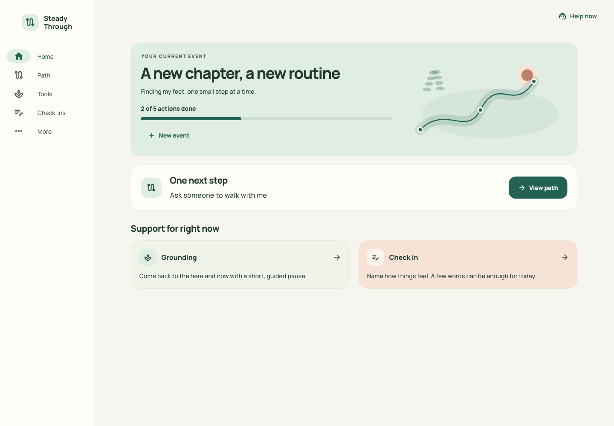
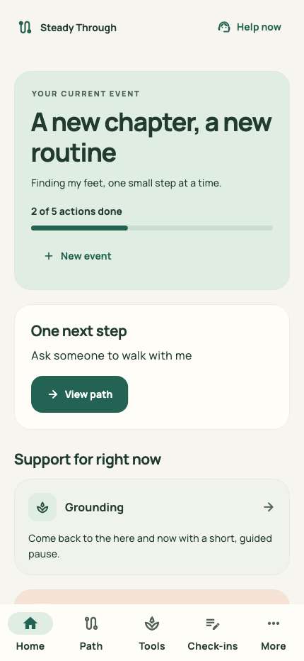
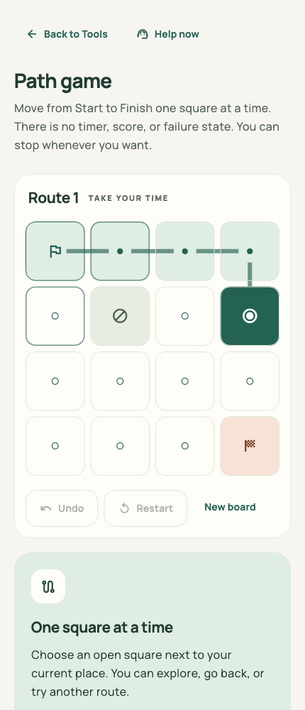
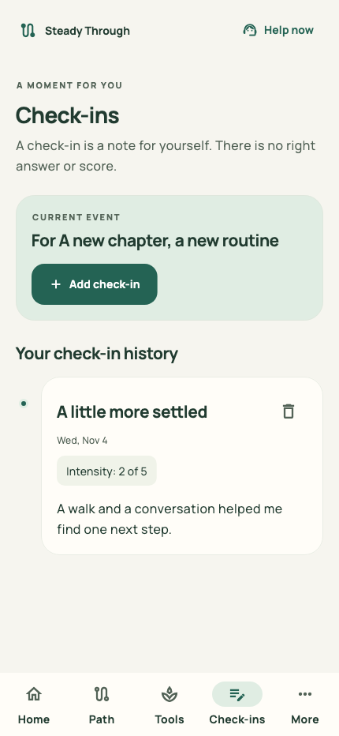
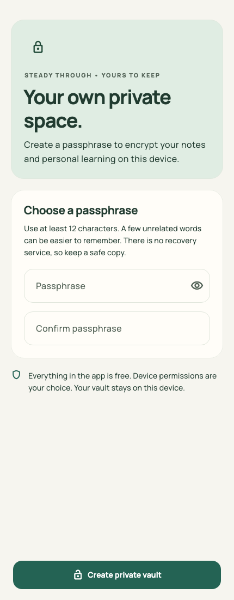
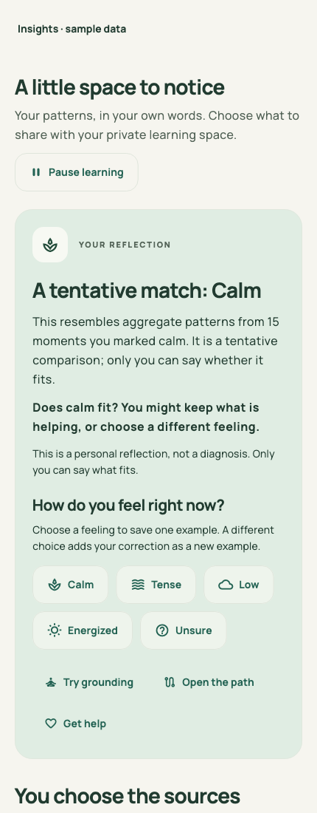
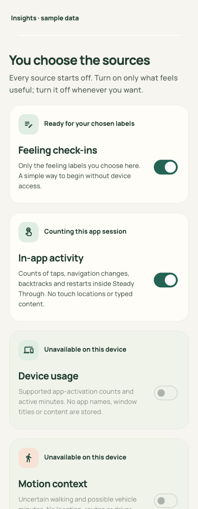
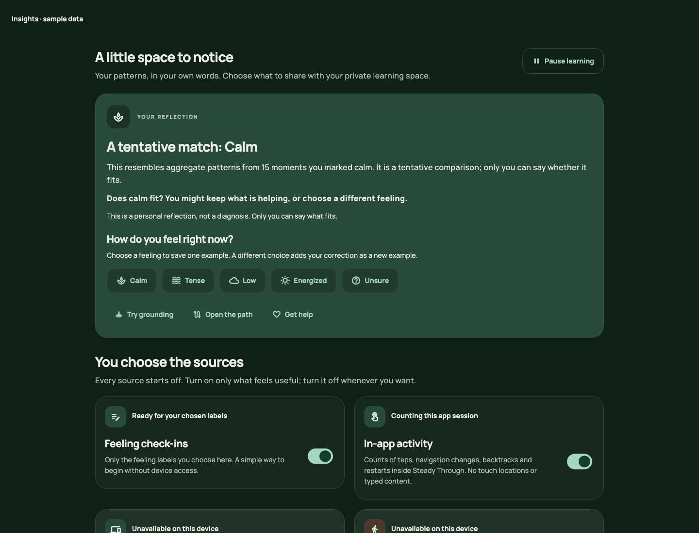
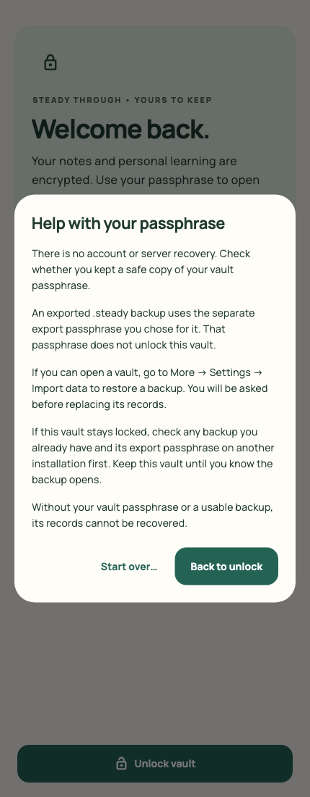
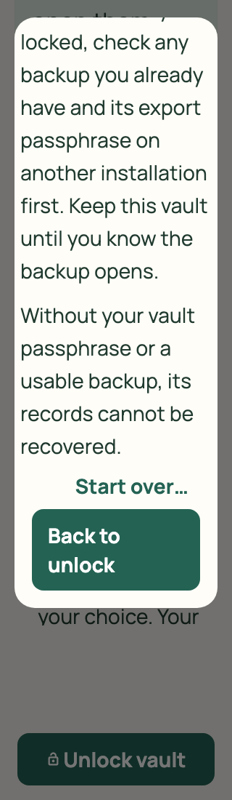

# Steady Through


Steady Through is a free, offline-first Flutter app for getting through a difficult life event one manageable action at a time. One codebase targets Android, iOS, macOS, Windows, and Linux. There is no account, subscription, app-operated server, or cloud emotion service.

<a id="current-151-work-in-progress--verification-and-publication-pending"></a>

<a id="current-151-preview--published-and-verified"></a>

## Current 1.5.1 preview — published and verified

**[v1.5.1-preview.1](https://github.com/BeauDevCode/steady-through/releases/tag/v1.5.1-preview.1) /1.5.1+10** is published from exact tagged source `4c8206812a2a23ab238c2e523a2d7ab04d30a654`. [CI run 42329671305](https://github.com/BeauDevCode/steady-through/actions/runs/42329671305), attempt 1, passed all seven jobs: **468 Flutter tests, 94 Python helpers, 12 Android JUnit tests and all four required native cases on each of five runtimes**. All 13 artifact ZIPs, six complete packages and ten public assets passed source/hash/size checks. The independent audit returned `PASS_WITH_LIMITS`, no findings/advisories. Exact draft/public body and server hashes/sizes/states matched; repository, release and all ten downloads returned anonymous HTTP200.

This reliability release preserves queued learning evidence and snapshot ownership, keeps submitted forms stable, reports Help Copy failures honestly and requests known residual-copy cleanup after deletion/import. Schema **4/read 1/2/3/4**, encryption/KDF, dependencies, adapters, permissions and learning thresholds stay unchanged; support remains free/offline with all sources off.

Local checks recorded no analyzer issues, 116 Dart files with no formatting changes and 21 inspected fictional actual-widget captures. Whole-branch review and one regression-verified P2 fix pass completed: committed imports now publish source-off/replacement state before residual cleanup, stopping collectors promptly; warning notification remains conditional. Two failures plus the passing primary-failure baseline became three passes, with no unresolved material finding.

Earlier local Mac attempts remain separate: three passes/one legacy unlock failure, then an inactive/hidden stalled rerun stopped with an incomplete report. Neither established a clean local four-case pass or a source defect. Controlled final-source CI subsequently passed all four Mac cases and all four on every other runtime.

The fourth native case uses default visible screens and real owned encrypted storage through guide/two-step creation, focused Mark/Undo/Mark, People edits and Help/View all, then a fresh authenticated Gate/Store reopen. It does not execute production main(), personal storage, installed-release/process-restart behavior or real external handlers. Captures do not validate native accessibility or establish a new pixel comparison.

The owner selected **Source and Simulator for now** for iPhone. Owner signing/provisioning and physical installation are outside this completion target. The device archive remains **unsigned, not installable and physically untested**. Real contact/clipboard/file handlers, OS dialogs/grants, physical sensing, native assistive technology and efficacy remain unexecuted.

Public-main ancestry/documentation equivalence remains pending its first post-publication proof; no completed result or snapshot is claimed yet. [Verified evidence](docs/quality-status.md#current-151-preview--verified-evidence) and [1.5.1 decisions](docs/releases/1.5.1-decisions.md) retain the detail. The 1.5 record below remains historical.

<a id="current-150-work-in-progress--ci-and-publication-pending"></a>

<a id="current-150-preview--published-and-verified"></a>

## Published 1.5.0 preview — historical verified evidence

**[Download v1.5.0-preview.1](https://github.com/BeauDevCode/steady-through/releases/tag/v1.5.0-preview.1)**, app version **1.5.0+9**, adds **Quick support and one next action**. Help previews the first three trusted people in saved order and opens the full People route. Add/Edit trims names, rejects a blank name and permits clearing an optional phone while preserving the person's ID, order and other records. Call, Text and Copy remain explicit actions with failure feedback and a visible-number/copy fallback; no real call or text handoff has been tested.

Home's **Go to this step** opens the existing exact action in **Your next step**, with explicit Mark step done/Undo completion, Help, Back and View full path. Navigation does not complete a step or automatically advance. Document/event/action guards reject unavailable or replaced targets. The whole app remains free and offline with all sources off; schema **4/read 1/2/3/4**, encryption, native adapters, permissions and learning remain unchanged.

All seven jobs passed on exact tagged source **`5b9b661ce8e16dada74079f8e5b1bb675325dfde`** in [CI run 42315634394](https://github.com/BeauDevCode/steady-through/actions/runs/42315634394), attempt 1: **415 Flutter tests, 88 Python CI-helper tests, 12 Android native unit tests, and all three original native application cases on each of five runtimes**. All 13 CI artifact ZIPs matched source/run/job bindings and outer hashes/sizes; all six package payloads were read and applicable binary versions checked. All ten public assets match server hashes/sizes and the release body matches the audited notes exactly; the repository, release and every download returned anonymous HTTP200.

Local verification also recorded no analyzer issues and 109 Dart files checked with no formatting changes. Whole-branch review and one regression-verified fix pass completed: one P2 allowed later Add/Edit corrections during a pending save to be lost. Both fields are now read-only while saving; Cancel remains available and failure restores editing/retry. All three capture profiles passed; all 24 fictional actual-widget captures were inspected. They show non-saving states; the save-only fix adds no new pixel-comparison or native evidence.

The native encrypted backup case passed with edited fictional people, a cleared optional phone, stable IDs/order, focused-completion API persistence, ratings and other records/settings. It does not execute native Help/People/focus navigation or contact handoffs. The separate iPhoneOS Release archive has 82 members and four verified arm64/platform 2 images, minimum iOS 15.0; it is **unsigned, not installable and physically untested**. Android uses development signing, macOS is not notarized and Windows/Linux are unsigned. Physical grants, actual OS dialogs, native assistive technology, distribution signing/notarization and efficacy remain unexecuted. Public-main ancestry and documentation-only equivalence were verified at the observation recorded in the [publication snapshot](docs/releases/1.5.0-publication.json); later documentation-only records preserve the tested application source. See [verified evidence](docs/quality-status.md#current-150-preview--verified-evidence) and [1.5 decisions](docs/releases/1.5.0-decisions.md). Published 1.4 evidence below remains historical.

<a id="current-140-preview--published"></a>

## Published 1.4.0 preview — historical evidence

**[Download v1.4.0-preview.1](https://github.com/BeauDevCode/steady-through/releases/tag/v1.4.0-preview.1)**, app version **1.4.0+8**. **What helps you** adds optional private tool ratings, a full editable history and a dated idea from a tool whose latest answer is Helpful. Every tool stays free with all learning sources off. Ratings are personal preferences, separate from feelings and effectiveness evidence. Breathing adds Done for now, fresh attempts, foreground/Help pause and a static reduced-motion circle.

All seven jobs passed on exact source **`a0a12ecc7badf359411e520b21a4081dcd06854d`** in [CI run 42308127205](https://github.com/BeauDevCode/steady-through/actions/runs/42308127205): **354 Flutter tests, 88 CI-helper tests, 12 Android native unit tests, and all three original native application cases on each of five runtime targets**. A fresh whole-branch review and one regression-verified fix pass completed; all 28 fictional feedback captures were inspected, including wrapping choices at 320px/200% text. All 13 artifact ZIPs matched recorded hashes/sizes; all six package payloads and applicable version resources were checked. All ten published assets matched server hashes/sizes, and the repository, release and every download returned anonymous HTTP200. See [verified evidence](docs/quality-status.md#current-140-preview--verified-evidence) and [implementation decisions](docs/releases/1.4.0-decisions.md).

Six packages include Android, iOS Simulator, a separate unsigned iPhoneOS Release archive, macOS, Windows and Linux. **The iPhoneOS archive is unsigned, not installable and physically untested.** Android uses development signing, macOS is not notarized, and Windows/Linux are unsigned. Real permission/file dialogs, physical sources, native assistive technology, store signing and human outcomes remain separate work. Preserve an encrypted backup before replacing an older Android preview.

This version writes **schema 4** and reads validated **1/2/3/4**. Older documents migrate with empty ratings and default settings while preserving existing plans, guides and learning. An app supporting only up to 3 cannot read new 4 vaults/exports. Keep a usable older backup if you may return to an older app; a new export also uses 4. There is no silent downgrade or plaintext fallback. [Privacy details](PRIVACY.md).

## Previous published previews

**[v1.3.0-preview.1 is published](https://github.com/BeauDevCode/steady-through/releases/tag/v1.3.0-preview.1)**, with app version **1.3.0+7**, private saved-moment history, exact-record Undo, in-place feeling corrections and clearer Insights. All seven jobs passed in [CI run 42293841631](https://github.com/BeauDevCode/steady-through/actions/runs/42293841631): **309 Flutter tests, 88 CI-helper tests, 12 Android native unit tests, and all three application cases on each of five runtime targets**. The tag is exact tested source `3dd1fe72dfceb1f9d7ae5716a479c11e2faff65f`. All ten public assets matched server SHA-256 hashes/sizes and were anonymously accessible. See the [verified evidence record](docs/quality-status.md#current-130-preview--verified-evidence) and [research-informed design](docs/superpowers/specs/2026-11-06-saved-moments-design.md). The separate iPhone ZIP remains unsigned, not installable and physically untested.

[Download the saved-moments preview](https://github.com/BeauDevCode/steady-through/releases/tag/v1.3.0-preview.1) · [Current validation and remaining limits](docs/quality-status.md)

**Previous release: [v1.2.1-preview.1 is published](https://github.com/BeauDevCode/steady-through/releases/tag/v1.2.1-preview.1)** with app version **1.2.1+6**, non-destructive passphrase help and a separate unsigned iPhoneOS Release package. All seven jobs passed in [CI run 42270965635](https://github.com/BeauDevCode/steady-through/actions/runs/42270965635): **264 Flutter tests, 88 CI-helper tests, 12 Android native unit tests, and all three application cases on each of five runtime targets**. All ten uploaded assets matched their server SHA-256 hashes/sizes and were anonymously accessible. The tag is the exact tested source `0f62db5ee2ba0e0769273de5872b1214ea6bafc5`. See the [verified evidence record](docs/quality-status.md#current-121-preview--verified-evidence). The iPhone ZIP is unsigned, not installable and physically untested; the [iOS distribution guide](docs/ios-distribution.md) separates it from the Simulator package and a future signed archive/IPA.

As historical evidence, **1.2.0+5** passed all six jobs in [CI run 42198257234](https://github.com/BeauDevCode/steady-through/actions/runs/42198257234): 255 Flutter tests, 62 CI-helper tests, 12 Android native unit tests, and all three application cases on each of five platforms. **[v1.2.0-preview.1 is published](https://github.com/BeauDevCode/steady-through/releases/tag/v1.2.0-preview.1)** with five platform packages and four verification files. All nine uploaded assets were checked against their server SHA-256 hashes; these results do not validate later source revisions.

The app is for personal organization and general self-help. It does not diagnose, measure stress, provide treatment, or replace emergency or professional support. In immediate physical danger, contact local emergency services. In the United States, call or text **988** for crisis support; elsewhere, use your local crisis service. See [Help from NIMH](https://www.nimh.nih.gov/health/publications/my-mental-health-do-i-need-help) and the [988 Lifeline](https://988lifeline.org/get-help/).

## What it does

- Keep several life events, choose the one to focus on, and work through five stages: Get oriented, Settle, Find support, Make a plan, and Reflect. Home and Path recommend the earliest unfinished stage, including an earlier-stage step added later. Add, rename, complete, or remove steps. Finish, reopen, or delete an event.
- Choose an optional guide for each event: General, School & growing up, Adult life changes, Caring for someone, or Later life changes. Choose any starter steps, including none, and add more from Path. Each guide has standard and Simple words prompts. Changing a guide or reading style keeps saved steps, edits and completion states intact. The guide is your choice; the app does not infer it from age, activity or feelings, and a helper can read along without a separate account.
- Use optional, self-paced grounding and gentle breathing tools. Grounding has Skip and Stop; breathing adds Done for now after Start and pauses on backgrounding or Help without automatically resuming. Reduced motion keeps its circle static while pace text remains usable. Stop, Back and Help stay available without requiring a rating.
- Play an optional, untimed path game with Undo and Restart. The app can describe moves such as backtracks and offer a break. After a round, **you** choose whether it felt calm, tense, or neither. Moves alone are not a validated stress measure, diagnosis, or score. Only round summaries and your answer are kept, not a raw tap trace.
- Optionally choose Helpful or Not this time after a tool, or add a manual rating even if you stopped early. Skip, Stop, Help and reaching an ending save no rating by themselves. Review, change or delete exact entries in Your tool ratings; Clear ratings removes that history while preserving its two settings and other records. What helps you shows descriptive counts/latest answers and can offer a tool whose latest retained answer is Helpful. It opens only after a tap, and every ordinary tool stays available.
- Write event-specific check-ins in your own words, with an optional 1–5 intensity and note.
- Reach the first three saved trusted people from Help and open the full People route. Add or edit a trimmed name and optional phone without changing the person's identity/order; clearing the number is allowed. Explicit Call, Text and Copy actions handle failures while leaving the number visible. No contacts permission is requested.
- Open Home's exact next action in Your next step. Mark it done or Undo completion explicitly, return Home, reach Help or view the full Path. No completion or automatic next-action navigation happens merely by opening it; stale or replaced targets show an unavailable state.
- Choose light or dark appearance and a Simple words reading style. No birth date is required. A trusted adult or helper can read along.
- Keep records and settings in a passphrase-protected encrypted local vault. Lock it when you choose; a privacy cover hides the app when it is inactive, and returning after five minutes away requires an unlock.
- Choose optional Insights sources: your feeling labels, aggregate activity inside this app, and supported device usage or motion summaries. In a new vault, every source starts off. Imports may restore manual and in-app source choices; system usage and motion sources reset off. Planning, tools, people and help remain available with every source off or every OS permission declined.
- Review the latest saved feelings or open the full private history. Inspect each moment’s local time and the aggregate readings actually saved with it. Correct a feeling in place, confirm deletion of one moment, or undo the latest committed save. A seven-day self-report summary works with every source off. Expand **How learning works** for actual evidence coverage and the separate 60-day review.
- Export an encrypted `.steady` copy with its own passphrase. Import an encrypted copy or validated legacy JSON with confirmation before it replaces all app data. Clear learning or game history independently, or delete all local app data with confirmation.

Event check-ins are deleted with their event. Game history belongs to the person and remains until cleared separately or removed by Delete all. [Privacy and data details](PRIVACY.md) explain local storage, exports, backups, and deletion.

The working app writes **version 4** documents and reads validated versions **1, 2, 3 and 4**. Older version 1/2 events receive the General guide without changing their existing steps; version 3/4 documents must preserve valid guide metadata. Versions 1/2/3 migrate with empty tool ratings and default rating settings. Apps that understand only up to version 3 cannot read new version 4 vaults or exports; keep a usable older backup before upgrading if you may need to return to an older app. There is no silent downgrade or plaintext export fallback.

## Your tool ratings

**Show optional ratings after tools** and **Use my ratings for ideas** each default on and persist independently. Hiding prompts leaves manual Add a rating and history management available. Turning ideas off stops the suggestion without deleting ratings. All rating ownership works with learning sources off or learning paused; a rating never enables a source, trains the feeling model or creates a GameRound.

Ratings retain only an ID, UTC time, tool and explicit answer in the existing encrypted vault and independently encrypted export. The active history excludes future records, retains the inclusive last 180 days and keeps at most 1,000 entries. Corrections preserve ID, time and tool. Pruning runs at unlock, export and committed mutations; correction/deletion/pruning request removal of known older local copies. Cleanup can fail after a successful active-vault write, leaving a distinct warning. Exports and OS backups remain outside local deletion control. Clear learning and Clear game history preserve tool ratings; Delete all resets them with other app records.

Current possible-vehicle context from the existing optional motion session suppresses rating prompts and mutation controls while Help and Back remain reachable. No new source or permission is requested; absent motion stays unknown. This is not a driving-detector guarantee. Queued rating changes reject replaced documents or expired foreground/tool attempts; an atomic save already begun may finish without showing success on a different attempt.

## Private learning

Insights compares aggregate observations with feelings you explicitly choose: Calm, Tense, Low, Energized or Unsure. A click, app activation or movement flag does not establish how you feel. With manual check-ins alone, Insights can describe your self-reported trend. A personal pattern comparison needs at least 20 examples across seven observation days, at least five examples of each of two concrete feelings, and at least two comparable aggregate features. Unsure is saved as your answer but does not count as a concrete training class. Sparse, conflicting or missing evidence produces an insufficient-evidence or uncertain result; any match remains tentative. Each new feeling choice saves a new moment; use **Edit feeling** in saved history to correct that specific report without changing its time or observations.

Saved moments are shown newest first, with local display times; stored timestamps remain unchanged. Context descriptions come from the metrics actually saved, not current permissions. An empty snapshot means no aggregate readings were saved; it does not establish what sources were enabled then. Editing, deleting, undoing or pruning evidence clears the derived model and old review results. Existing review dates remain while moments remain; removing the last moment resets the window. Corrections request removal of older local recovery copies, with a committed-save warning if cleanup cannot be confirmed. Separately exported copies remain outside the app’s deletion control.

**How learning works** starts collapsed. Its counts describe input coverage, not demonstrated prediction accuracy. The 20-moment/7-day safeguards are app rules, not research-established accuracy guarantees. There is no quota to meet, no need to change feelings or enable a device permission, and no automatic collection reminder. The [design evidence and alternatives](docs/superpowers/specs/2026-11-06-saved-moments-design.md#evidence-and-approaches) distinguish research findings from implementation inferences.

After about 60 days, a local review can train a candidate on earlier examples and evaluate it on later held-out examples and a simple majority-label baseline. An update is adopted only when coverage and improvement checks pass, including improvement over an existing calibrated model. Time alone does not guarantee an update or establish real-world accuracy. Learning keeps at most 180 days or 1,000 labelled examples, whichever limit is reached first. Clear learning resets its examples, calibration and source choices without deleting events or other non-learning records.

Source access runs only during an unlocked, active app session. System sources require device-owner confirmation and a separate native grant where the platform requires one. No app names, window titles, typed content, screenshots, raw tap traces, GPS locations or routes are returned to the learning model or saved by these sources.

Guide context and event text are not learning inputs and never determine a feeling label or model result. If you explicitly enable In-app activity, taps and navigation while using guide controls can contribute to the same aggregate counters as other in-app actions; the chosen guide and step text are not recorded as features. Clear learning keeps guides, saved steps and other event records.

| Platform | Manual and in-app sources | Implemented system sources and limits |
| --- | --- | --- |
| macOS | Available without device permissions | NSWorkspace activation counts only while Steady Through is in the foreground, plus screen-awake collector-session duration within the last 60 minutes. It does not observe switching among other apps; the activation count may stay zero. Session duration does not measure attention. Motion is unavailable. |
| Android | Available without device permissions | Permission-gated UsageStats events aggregated over the last 60 minutes; incomplete event history can undercount. Optional uncertain vehicle/walking context uses Google Play services Activity Recognition while the session runs and needs a separate motion grant. |
| iOS | Available without device permissions | Optional Core Motion summaries, where the device supports them. History may be delayed or incomplete. Cross-app usage is unavailable in this preview: no Family Controls entitlement or Screen Time extensions are configured. |
| Windows and Linux | Available without device permissions | System usage and motion adapters are not implemented. Missing readings stay unavailable. |

Vehicle context is uncertain and cannot identify a driver or distinguish a passenger. When current motion indicates possible vehicle movement, Insights suppresses interactive reflection prompts and asks you to return when safely stopped. Help remains reachable. There are no driving-time notifications, route maps, driving scores or emotion diagnoses.

The platform design follows [Android UsageStatsManager](https://developer.android.com/reference/android/app/usage/UsageStatsManager), [Google ActivityRecognitionClient](https://developers.google.com/android/reference/com/google/android/gms/location/ActivityRecognitionClient), [Apple NSWorkspace](https://developer.apple.com/documentation/appkit/nsworkspace), [Core Motion](https://developer.apple.com/documentation/coremotion/cmmotionactivitymanager), and [Family Controls entitlement requirements](https://developer.apple.com/documentation/familycontrols/requesting-the-family-controls-entitlement). Implemented availability is separate from device verification; see the [current quality status](docs/quality-status.md).

## The local vault

On first use, create a passphrase of at least 12 characters. All app records, settings, learning examples and labels are encrypted with AES-256-GCM. PBKDF2-HMAC-SHA256 derives the key with 600,000 iterations and a random salt; every save uses a fresh nonce. Exports are independently encrypted `.steady` files with the passphrase you choose for that copy. The passphrase is not saved, and there is no recovery service. If you forget its passphrase, that vault or export cannot be unlocked; recovery requires another copy whose passphrase you still know.

On the locked screen, **Forgot your passphrase?** opens guidance without reading, decrypting or replacing records, finding backups, or resetting the vault. **Back to unlock**, Escape/Back or dismissing the dialog keeps the vault. A backup uses its own export passphrase, which does not unlock the local vault. Check a backup you already control and its passphrase on another installation before discarding a locked vault. Only **Start over…** opens the existing reset confirmation; resetting still requires typing `DELETE`. Without the vault passphrase or a usable backup, the records cannot be recovered.

An older local JSON document is migrated only after the encrypted vault is written, authenticated and read back. The app then removes its known legacy primary, backup and temporary files. If removal fails, it displays a cleanup warning and retries on unlock; older plaintext copies may remain until cleanup succeeds. System usage and motion sources are switched off on import and require fresh device-owner confirmation before re-enabling them on this device. Historical learning examples and calibration are preserved. Legacy JSON selected for import remains where you selected it. A wrong passphrase or damaged vault does not silently create a new empty vault.

A save or import that has reached the active encrypted vault remains successful if cleanup of older known copies then fails. A persistent warning explains that remaining cleanup; ordinary saves do not clear it. Lock and unlock to retry cleanup. A failure before the save commits still leaves the active records unchanged. Vault reset requires typing `DELETE`, shows deletion progress, and prevents a competing unlock while storage is being removed.

Encryption protects saved files, not an already compromised unlocked device. An unlocked session necessarily holds readable records and a derived key in memory. Locking closes the key object and removes the app's reference; the app does not promise to erase every copy held by the runtime or operating system. Device backups and exported copies are outside the app's deletion controls. Read [PRIVACY.md](PRIVACY.md) before storing sensitive information or sharing an export.

## App preview

The redesigned interface uses bundled typography and original route artwork. These captures use synthetic sample entries. The vault and Insights screens below show the new private-learning flow; the Home and game captures show the existing support tools.



  

  



The recovery captures below use the real locked/help UI with empty synthetic passphrase fields and no disk vault, learning session, grant, backup discovery or reset. They show the safe return action and narrow/keyboard layout; they do not establish physical-device or screen-reader usability.

 

Regenerate recovery captures with `flutter test --no-pub --concurrency=1 --update-goldens tool/capture_recovery_ui_test.dart`; inspect all 11 `docs/screenshots/recovery-*.png` files from its four profiles. Regenerate visual review captures with `flutter test --update-goldens tool/capture_ui_test.dart` and `flutter test --update-goldens tool/capture_learning_ui_test.dart`. The normal test suite checks navigation, persistence, errors, and layouts with long entries at 320 and 1200 pixels with 200% text.

## Set up locally

Install [Flutter 3.47.9](https://docs.flutter.dev/install/archive), verify the required platform toolchain with `flutter doctor -v`, then run:

```sh
flutter pub get
flutter analyze
flutter test
flutter run
```

`flutter run` needs a connected device, simulator, emulator, or supported desktop host. Android development requires an Android SDK. iOS and macOS builds require macOS and Xcode. Windows desktop builds require Visual Studio with the Desktop development with C++ workload. Linux desktop builds require `clang`, `cmake`, `ninja-build`, `pkg-config`, `libgtk-3-dev`, and `libstdc++-12-dev`. See Flutter's [platform setup](https://docs.flutter.dev/platform-integration), [Windows setup](https://docs.flutter.dev/platform-integration/windows/setup), and [Linux setup](https://docs.flutter.dev/platform-integration/linux/setup).

## Build by platform

Run these commands from the repository root after `flutter pub get`, on a host with that platform's toolchain:

| Target | Command | Output and scope |
| --- | --- | --- |
| Android | `flutter build apk --release` | `build/app/outputs/flutter-apk/app-release.apk`; this project does not provide a Play upload key. The generated development signing configuration may sign this APK with a debug key. |
| iOS simulator | `flutter build ios --simulator --debug` | `build/ios/iphonesimulator/Runner.app`; a debug simulator app, not an iPhone install package. |
| iPhoneOS Release, unsigned | `flutter build ios --release --no-codesign --target lib/main.dart` | `build/ios/iphoneos/Runner.app`; unsigned and not installable. Follow the [directory and archive verification steps](docs/ios-distribution.md#build-and-verify-the-unsigned-device-package) before packaging. |
| macOS | `flutter build macos --release` | App bundle in `build/macos/Build/Products/Release/`; no distribution certificate or notarization is supplied. |
| Windows | `flutter build windows --release` | Bundle in `build/windows/x64/runner/Release/`; keep the executable, DLLs, and data together. |
| Linux | `flutter build linux --release` | Bundle in `build/linux/x64/release/bundle/`; keep the executable and data together. |

The GitHub Actions workflow is configured for **seven jobs**: shared analysis/tests, the five existing production/native targets, and the separate unsigned iPhoneOS Release build/validator. Each native target must run all four required application cases, preserving the original three plus the rendered support/reopen journey; the new device job compiles and validates a package without executing it. Archive production packages before integration-test recompilation, keeping `lib/main.dart` in the packaged app. As historical 1.2.1 evidence, all seven jobs passed on exact source `0f62db5ee2ba0e0769273de5872b1214ea6bafc5` in [run 42270965635](https://github.com/BeauDevCode/steady-through/actions/runs/42270965635); the [quality record](docs/quality-status.md) separates the runtime/package evidence from unexecuted physical, signing and manual checks.

The native suite keeps every source off and uses actual encryption/KDF/filesystem. Its current backup fixture extends guidance/ratings preservation with edited fictional people, cleared optional phone, stable IDs/order and the focused-completion controller API through restore and authenticated reopen. The 1.5 fixture passed on all five native runtimes; it does not exercise native Help/People handoffs or focused-route navigation. File selection and confirmation are scripted callbacks, with actual OS dialogs and physical sources checked separately. A successful build is a compilation check, not a device usability test, medical validation, store approval, or signed release. App Store/TestFlight distribution needs user-owned Apple signing and provisioning; see the [iOS handoff](docs/ios-distribution.md). Play distribution needs a release signing key and a store-ready bundle. Preview Android APKs can use different development keys between builds. Export a backup before replacing an older preview; a signing mismatch can require uninstalling the old app, which removes its local data. Review Flutter's [Android release](https://docs.flutter.dev/deployment/android) and [iOS release](https://docs.flutter.dev/deployment/ios) guides before distribution.

## Source basis and limits

The tools use original wording informed by the [WHO guide to stress self-help](https://www.who.int/thailand/activities/doing-what-matters-in-times-of-stress). [NIMH guidance](https://www.nimh.nih.gov/health/publications/my-mental-health-do-i-need-help) informs the recommendation to seek professional help when distress worsens or interferes with daily life. The U.S. crisis option is based on the [988 Lifeline](https://988lifeline.org/get-help/). These sources do not validate this app's game, check-ins, or exercises as clinical instruments. The app does not infer a medical state from play.

The context guides use original short copy informed by the six authoritative references in the [guidance content note](docs/guidance-content.md), including child/adolescent, caregiving and later-life resources. These are optional planning ideas rather than clinical programs, age classifications or claims of effectiveness. No diagnosis, birth date, assumed retirement or caregiver relationship is required.

The privacy approach draws on [FTC mobile health app practices](https://www.ftc.gov/business-guidance/resources/mobile-health-app-developers-ftc-best-practices). Accessibility work draws on [W3C guidance for mobile apps](https://www.w3.org/TR/wcag2mobile-22/), which is informative guidance rather than a certification. Any future store release must also be reviewed against [Apple's App Review Guidelines](https://developer.apple.com/app-store/review/guidelines/) and applicable platform rules.

Steady Through's path game and personal model have not been validated as measures of stress or emotion across ages. A separate [game-based cognitive aging study](https://pubmed.ncbi.nlm.nih.gov/41322085/) studied adults aged 18–75 and predicted chronological age from cognitive-game metrics; that result does not validate this app's game or establish stress detection in children or older adults. Steady Through treats moves as a prompt for reflection and relies on the player's own answer.

## Contributing and license

See [CONTRIBUTING.md](CONTRIBUTING.md) for development and review expectations. Source code is available under the [MIT License](LICENSE).

The bundled [Manrope typeface](https://github.com/google/fonts/tree/main/ofl/manrope) uses the SIL Open Font License; its license is included in `assets/fonts/OFL-Manrope.txt`. Fonts and original route artwork are available offline.
